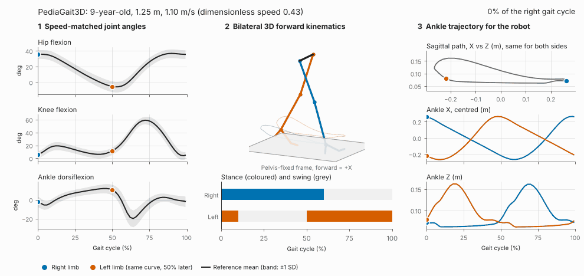
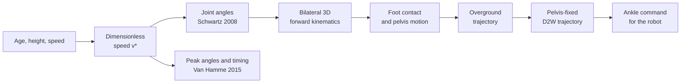
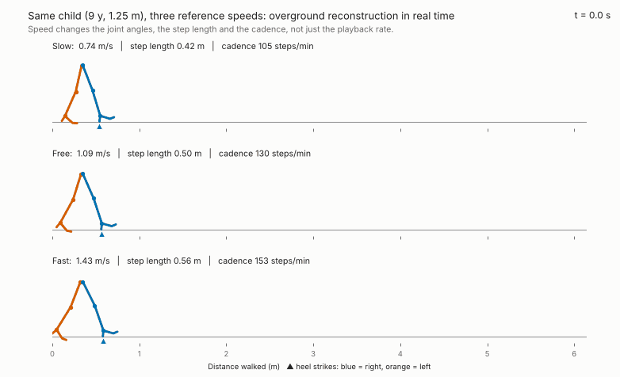
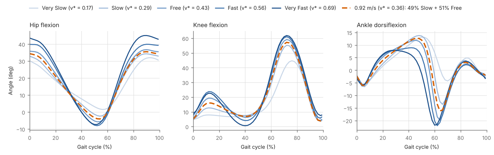

# PediaGait3D

Normative pediatric gait trajectory reconstruction from subject parameters,
published reference models, and a D2W-compatible kinematic transform.

Give it a child's **age, height and walking speed**. It returns the reference
joint angles for that speed and an approximate **3D trajectory of the lower
limbs** over one gait cycle, as CSV tables, figures and an animation.



*One gait cycle for a 9-year-old, 1.25 m tall, walking at 1.10 m/s. Left:
reference joint angles for that speed. Centre: both limbs reconstructed in 3D.
Right: the ankle trajectory exported for a gait robot.*

The package is intended as a reproducible reference generator. It is not a
validated clinical inverse-kinematics pipeline, not a BTS/Helen-Hayes
implementation, and not a force/contact dynamics model.

## What it proposes

Gait robots and gait studies need a reference of how a typically developing
child of a given size walks at a given speed. Published normative data answer
this for joint *angles*, in a handful of speed categories. PediaGait3D closes
the gap between those tables and a usable 3D trajectory:

1. **Speed-matched angles.** Walking speed is made dimensionless with leg
   length and used to interpolate the full-cycle angular waveforms of
   Schwartz et al. (2008) between their speed groups.
2. **Age and speed reference values.** Peak angles and their timing are
   predicted with the regressions of Van Hamme et al. (2015).
3. **3D reconstruction.** The angles drive a bilateral forward-kinematic model
   scaled to the child's height. A heel-forefoot-toe contact model places the
   feet on the ground and yields the pelvis motion.
4. **Three output layers.** Overground walking, the same gait on a
   pelvis-fixed treadmill frame, and an ankle-only trajectory in the D2W robot
   convention.
5. **Self-reported diagnostics.** Every run writes a table of geometric quality
   checks next to the trajectories.



Speed is not a playback rate. A faster walk has different joint angles, a
longer step and a higher cadence, and the reconstruction follows all three:



*The same child at the Slow, Free and Fast reference speeds, played in real
time from `world_spatial_joint_trajectories.csv`. Only the lower limbs are
modelled.*

## Quick start

```bash
git clone https://github.com/Romerozabal/pedia-gait3d.git
cd pedia-gait3d
python3 -m venv .venv
source .venv/bin/activate
pip install -r requirements.txt

python3 generate_integrated_normative_gait.py \
  --config configs/subject_gait_config.comfortable_speed.example.json
```

Expected console output:

```text
patient_id=subject_comfortable
dimensionless_speed=0.4315 -> Schwartz group: Free (inside_reported_range)
angular_waveforms=Free_to_Fast mode=linear alpha=0.0190 (linear_interpolation_between_group_means)
wrote tables and figures to .../outputs/subject_comfortable
```

Then open `outputs/subject_comfortable/figures/` for the figures and the
animation, and `outputs/subject_comfortable/tables/` for the data.

To generate your own subject, copy the example config and edit four values:

```json
{
  "patient_id": "subject_comfortable",
  "age_y": 9.0,
  "height_m": 1.25,
  "speed_m_s": 1.1
}
```

The same can be done without a file:

```bash
python3 generate_integrated_normative_gait.py \
  --patient-id S01 --age-y 6 --height-m 1.15 --speed-m-s 0.9
```

Batch runs from a CSV, every configuration option, and examples of loading the
tables with pandas are described in the [usage guide](docs/USAGE.md).

## Inputs

| Parameter | Required | Meaning |
|-----------|----------|---------|
| `patient_id` | yes | Label for the run and its output folder. |
| `age_y` | yes | Age in years. Used by the Van Hamme regressions. |
| `height_m` | yes | Height in metres. Scales the body segments. |
| `speed_m_s` | yes | Walking speed in metres per second. |
| `leg_length_m` | no | Measured leg length. Estimated as `0.530 * height_m` when omitted. |
| `n_points` | no | Samples per gait cycle (default 100). |
| `schwartz_speed_interpolation` | no | `linear` (default) or `nearest`. |
| `contact_model` | no | Foot contact pattern and stance timing. |
| `out_dir` | no | Output folder inside the repository (default `outputs/<patient_id>`). |

Dimensionless speed is computed as:

```text
v* = speed_m_s / sqrt(g * leg_length_m)
g  = 9.81 m/s^2
```

`configs/subject_gait_config.example.json` describes a very slow,
robot-assisted walk (0.20 m/s). It falls below the slowest reference group, so
the Very Slow waveforms are used unchanged; the run reports this in its console
output and in `patient_context.csv`.

## Outputs

Each execution writes:

```text
outputs/<patient_id>/
├── README_OUTPUT.md
├── tables/
│   ├── patient_context.csv
│   ├── normative_spatiotemporal_reference.csv
│   ├── van_hamme_age_speed_discrete_reference.csv
│   ├── schwartz_speed_matched_angular_profiles.csv
│   ├── d2w_kinematic_model_proportions.csv
│   ├── contact_phase_model.csv
│   ├── world_spatial_joint_trajectories.csv
│   ├── d2w_style_spatial_joint_trajectories.csv
│   ├── d2w_ankle_command_trajectories.csv
│   └── spatial_reconstruction_quality.csv
└── figures/
    ├── spatial_trajectory_three_plane_views.png
    ├── spatial_trajectories_vs_normalized_gait_cycle.png
    ├── spatial_connected_segments_gait_cycle_gradient.png
    ├── schwartz_speed_matched_angular_profiles.png
    └── spatial_gait_3d_frontal_lateral_animation.gif
```

| If you need | Read |
|-------------|------|
| What the run decided (speed group, interpolation) | `patient_context.csv` |
| Step length, cadence, stride time | `normative_spatiotemporal_reference.csv` |
| Joint angles over the gait cycle, with ±1 SD | `schwartz_speed_matched_angular_profiles.csv` |
| Expected peak angles for the child's age and speed | `van_hamme_age_speed_discrete_reference.csv` |
| 3D joint positions while walking overground | `world_spatial_joint_trajectories.csv` |
| 3D joint positions relative to a fixed pelvis | `d2w_style_spatial_joint_trajectories.csv` |
| Ankle trajectory for the robot workspace | `d2w_ankle_command_trajectories.csv` |
| How consistent the reconstruction is | `spatial_reconstruction_quality.csv` |

The full-body spatial tables include pelvis, hip, knee, ankle, forefoot, toe,
and heel trajectories. The ankle-only command table is exported separately for
D2W/robot workspace compatibility and should not be interpreted as a complete
body skeleton.

Generated outputs are ignored by Git. The repository keeps `outputs/.gitkeep`
only so that the output root exists after cloning. The output folder is
resolved relative to the repository root; paths outside the repository are
rejected to keep generated files contained.

## How the speed matching works

Schwartz et al. report five speed groups. For a speed that lies between two
group means, the waveform is a linear blend of the two neighbouring curves.
Outside the published range the nearest curve is used and nothing is
extrapolated.



*Blue, light to dark: the five reference speed groups. Dashed orange: the
waveform generated for the same 1.25 m child at 0.92 m/s.*

The equations for every step, the angle sign conventions, the segment
proportions and the contact model are in the [methods page](docs/METHODS.md).

## Scope and limitations

The trajectories are generated references, not measured subject kinematics.
Before using them, note that:

- The reconstruction has not been validated against measured 3D gait data. The
  quality table reports internal geometric consistency only.
- Age changes only the Van Hamme reference table. The waveforms and the 3D
  trajectory depend on height, leg length and speed.
- Step length and cadence are taken from the nearest speed group and are not
  interpolated, unlike the angles.
- Leg length is estimated from height unless it is provided. A measured value
  is preferable.
- The model is a symmetric, lower-limb, kinematic model. It does not estimate
  contact force, pressure or centre of pressure, and it does not enforce foot
  clearance.
- The source cohorts are 4 to 17 years old (Schwartz et al.) and 1 to 7 years
  old (Van Hamme et al.).

The complete list, with numbers, is in
[METHODS.md](docs/METHODS.md#scope-and-known-limitations).

## Documentation

| Page | Content |
|------|---------|
| [docs/USAGE.md](docs/USAGE.md) | Installation, the three ways to run, configuration reference, output tables and figures, coordinate frames, pandas examples, troubleshooting. |
| [docs/METHODS.md](docs/METHODS.md) | Source models, equations, kinematic convention, reconstruction layers, quality metrics, limitations. |
| `outputs/<patient_id>/README_OUTPUT.md` | Written by every run: the inputs and method notes for that subject. |

## Repository contents

```text
.
├── generate_integrated_normative_gait.py
├── configs/
│   ├── subject_gait_config.example.json
│   └── subject_gait_config.comfortable_speed.example.json
├── models/
│   ├── lam_schwartz_2008_anova_reference_long.csv
│   ├── lam_schwartz_2008_joint_rotation_reference_long.csv
│   └── lam_van_hamme_2015_regression_coefficients.csv
├── docs/
│   ├── USAGE.md
│   ├── METHODS.md
│   ├── make_readme_media.py
│   └── media/
├── outputs/
│   └── .gitkeep
├── PACKAGE_MANIFEST.csv
└── requirements.txt
```

`PACKAGE_MANIFEST.csv` holds SHA-256 checksums for the versioned files; the
check is described in the [usage guide](docs/USAGE.md#verify-the-package-manifest).
`docs/make_readme_media.py` regenerates the animations and figures of this
documentation from the generator's own functions.

## Sources

The repository distributes only the local CSV model tables consumed by the
generator. Original article PDFs and supplementary files are not included.
Users should obtain the cited source documents from the publishers when needed.

- Schwartz MH, Rozumalski A, Trost JP. The effect of walking speed on the gait
  of typically developing children. *J Biomech.* 2008;41(8):1639-1650.
  [doi:10.1016/j.jbiomech.2008.03.015](https://doi.org/10.1016/j.jbiomech.2008.03.015)
- Van Hamme A, El Habachi A, Samson W, Dumas R, Chèze L, Dohin B. Gait
  parameters database for young children: The influences of age and walking
  speed. *Clin Biomech.* 2015;30(6):572-577.
  [doi:10.1016/j.clinbiomech.2015.03.027](https://doi.org/10.1016/j.clinbiomech.2015.03.027)

The D2W transform convention (height-scaled segment vectors, the
`R = Rz * Ry * Rx` rotation order, pelvis-fixed treadmill projection and D2W
Cartesian sign remapping) is implemented directly in
`generate_integrated_normative_gait.py`.
