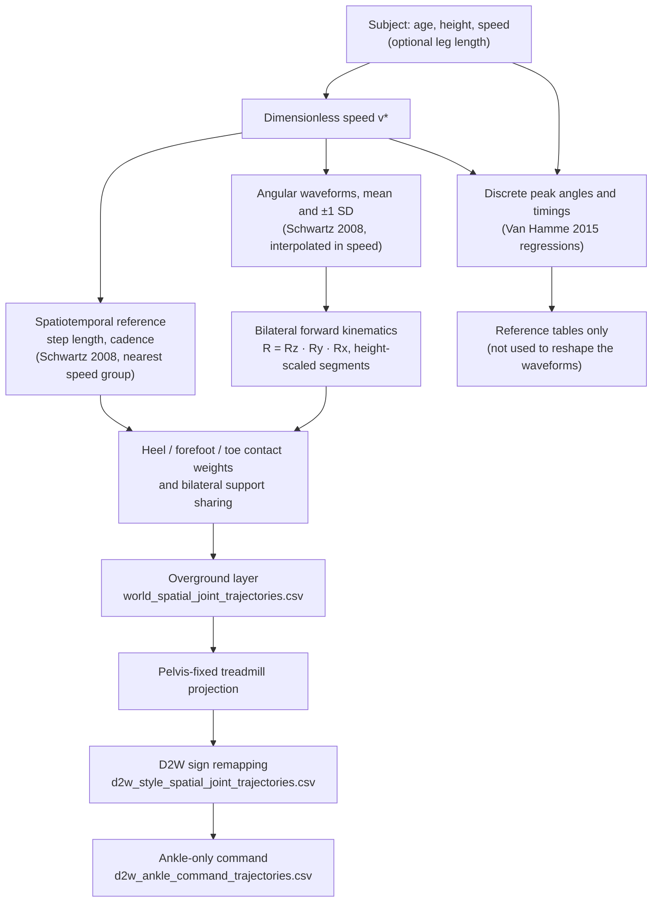
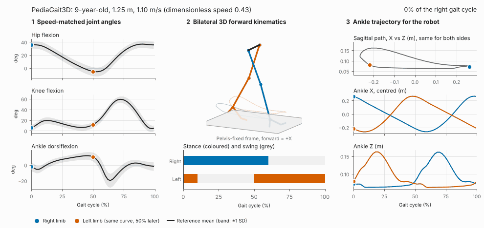
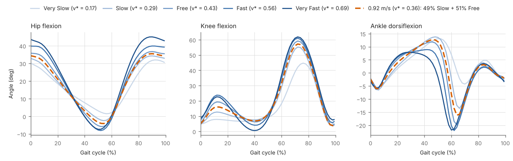
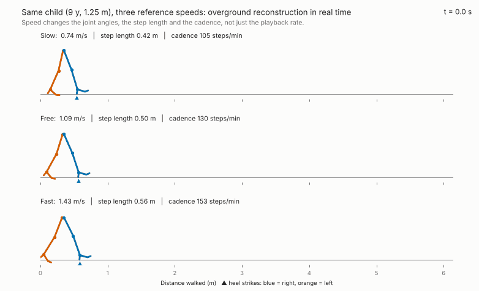

# Methods

This page documents how `generate_integrated_normative_gait.py` turns four
subject parameters into angular waveforms and 3D joint trajectories. For how to
run the tool and read its files, see [USAGE.md](USAGE.md). For a short overview,
see the [README](../README.md).

Contents:

- [Pipeline at a glance](#pipeline-at-a-glance)
- [Source models and local tables](#source-models-and-local-tables)
- [Dimensionless speed and speed group](#dimensionless-speed-and-speed-group)
- [Angular waveform construction](#angular-waveform-construction)
- [Kinematic convention](#kinematic-convention)
- [Segment geometry](#segment-geometry)
- [Spatial reconstruction workflow](#spatial-reconstruction-workflow)
- [Quality metrics](#quality-metrics)
- [Scope and known limitations](#scope-and-known-limitations)

## Pipeline at a glance





## Source models and local tables

The repository distributes only the local CSV model tables consumed by the
generator. Original article PDFs and supplementary files are not included.
Users should obtain the cited source documents from the publishers when needed.

### Schwartz et al. 2008

Schwartz MH, Rozumalski A, Trost JP. The effect of walking speed on the gait of
typically developing children. *J Biomech.* 2008;41(8):1639-1650.
[doi:10.1016/j.jbiomech.2008.03.015](https://doi.org/10.1016/j.jbiomech.2008.03.015)

The study reports 83 typically developing children aged 4 to 17 years walking
at speeds from very slow to very fast. It provides the speed-binned reference
used here for:

- full-cycle angular waveforms;
- dimensionless step length;
- dimensionless cadence;
- dimensionless speed bins.

Local model tables:

```text
models/lam_schwartz_2008_joint_rotation_reference_long.csv
models/lam_schwartz_2008_anova_reference_long.csv
```

The angular model table was derived from the Schwartz supplementary joint
rotation data. It contains 14 profiles, 5 speed groups, 3 statistics and 51
gait-cycle samples (every 2%) per curve:

```text
trunk_tilt          pelvis_tilt         hip_flex        knee_flex        ankle_dorsi
trunk_obliquity     pelvis_obliquity    hip_adduction   knee_adduction   foot_progression
trunk_rotation      pelvis_rotation     hip_rotation    knee_rotation
```

For each profile, the table stores:

```text
schwartz_speed_group
stat = mean, -1sd, +1sd
cycle_percent
value_deg
source metadata
```

The ANOVA table stores 47 discrete metrics per speed group (spatiotemporal,
kinematic, kinetic and EMG). The generator converts only the dimensionless step
length and cadence to subject units; the remaining rows are passed through to
`normative_spatiotemporal_reference.csv` as reference context.

The Schwartz supplement does not provide independent ankle frontal-plane or
ankle axial-rotation curves. This implementation therefore uses ankle
dorsi/plantarflexion as ankle pitch and foot progression as the terminal
foot/ankle yaw approximation.

### Van Hamme et al. 2015

Van Hamme A, El Habachi A, Samson W, Dumas R, Chèze L, Dohin B. Gait parameters
database for young children: The influences of age and walking speed.
*Clin Biomech.* 2015;30(6):572-577.
[doi:10.1016/j.clinbiomech.2015.03.027](https://doi.org/10.1016/j.clinbiomech.2015.03.027)

The study reports 106 healthy children between one and seven years of age. It
is used for discrete age/speed angular reference features. The local model
table stores regression coefficients in:

```text
models/lam_van_hamme_2015_regression_coefficients.csv
```

The implemented regression form is:

```text
Y = a * age
  + b * v*
  + c * age * v*
  + d
```

where `v*` is dimensionless walking speed. Ten features are covered, each as a
peak value (deg) and a time of occurrence (% of cycle):

| Code | Joint | Feature |
|------|-------|---------|
| `A_A1` | Ankle | Max plantarflexion (0-25%) |
| `A_A2` | Ankle | Max dorsiflexion (26-50%) |
| `A_A3` | Ankle | Max plantarflexion (51-75%) |
| `A_A4` | Ankle | Max dorsiflexion (76-100%) |
| `A_K1` | Knee | Max flexion (0-25%) |
| `A_K2` | Knee | Min flexion (26-55%) |
| `A_K3` | Knee | Max flexion (56-100%) |
| `A_H1` | Hip | Max flexion (0-15%) |
| `A_H2` | Hip | Min flexion (40-60%) |
| `A_H3` | Hip | Max flexion (70-100%) |

The exported band is `normal_mean ± residual_sd`. Nine derived rows are added
(sagittal peak angle, peak timing and range of motion for ankle, knee and hip).

These values are exported as discrete reference parameters. They do not
currently warp or rescale the Schwartz full-cycle angular waveforms.

Two points to keep in mind when reading this table:

- The regression outputs keep the sign conventions of the local coefficient
  table and are not converted to the Schwartz conventions. Knee flexion peaks,
  for example, come out negative here and positive in the Schwartz waveforms.
- The regressions are evaluated for any `age_y`. Outside the one to seven year
  range of the source cohort the values are extrapolations.

### D2W-compatible transform convention

The former D2W reference snapshot is not required at runtime and is not
distributed in this public repository. The relevant transform assumptions are
implemented directly in `generate_integrated_normative_gait.py`: height-scaled
segment vectors, the `R = Rz * Ry * Rx` rotation convention, pelvis-fixed
treadmill projection, D2W Cartesian sign remapping, and the separate ankle-only
command export.

## Dimensionless speed and speed group

If `leg_length_m` is not provided, the script estimates:

```text
leg_length_m = 0.530 * height_m
```

Dimensionless speed is computed as:

```text
v* = speed_m_s / sqrt(g * leg_length_m)
g  = 9.81 m/s^2
```

The Schwartz speed bins are:

| Group | Reported v* range | Group mean v* |
|-------|-------------------|---------------|
| Very Slow | 0.090 to 0.226 | 0.172 |
| Slow | 0.234 to 0.359 | 0.290 |
| Free | 0.372 to 0.482 | 0.429 |
| Fast | 0.502 to 0.636 | 0.560 |
| Very Fast | 0.638 to 0.844 | 0.694 |

The spatiotemporal values (step length, cadence, stride time) are taken from a
single group: the one whose reported range contains `v*`, or the group with the
closest mean when `v*` falls outside every range (below 0.090, above 0.844, or
in one of the small gaps between ranges). The assignment is recorded in
`patient_context.csv` as `schwartz_group_assignment_status`.

Conversion to subject units:

```text
step_length_m     = dimensionless_step_length * leg_length_m
cadence_steps_s   = dimensionless_cadence / sqrt(leg_length_m / g)
stride_time_s     = 2 / cadence_steps_s
```

## Angular waveform construction

For angular waveforms, `schwartz_speed_interpolation` controls whether the
script uses a single speed group or interpolates between groups:

```text
nearest: use the closest Schwartz group waveform
linear:  interpolate between adjacent Schwartz group mean-speed waveforms
```



The temporal interpolation to the requested gait-cycle grid is:

```text
t_i = 100 * i / N,  i = 0, 1, ..., N-1
theta_g(t_i) = interp(theta_g_source, t_i)
```

The source curves have 51 samples, so `n_points` above 51 resamples the curve
without adding information.

For `linear` speed interpolation:

```text
alpha = (v* - v_low) / (v_high - v_low)

theta(t_i, v*) =
    (1 - alpha) * theta_low(t_i)
  + alpha       * theta_high(t_i)
```

where `v_low` and `v_high` are adjacent Schwartz group mean dimensionless
speeds. Outside the published mean-speed range (`v*` below 0.172 or above
0.694), the angular waveform is clamped to `Very Slow` or `Very Fast`; no
extrapolation is performed.

The same weights are applied to the `-1sd` and `+1sd` curves. The spatial
reconstruction uses only the `mean` angular curves. The `-1sd` and `+1sd`
curves are exported and plotted for reference.

## Kinematic convention

The transform uses the D2W rotation order:

```text
R = Rz(yaw) * Ry(pitch) * Rx(roll)
```

The angular profile mapping used by the forward kinematic chain is:

```text
pelvis_roll  Rx = + pelvis_obliquity
pelvis_pitch Ry = - pelvis_tilt
pelvis_yaw   Rz = + pelvis_rotation

hip_roll     Rx = - hip_adduction
hip_pitch    Ry = + hip_flex
hip_yaw      Rz = + hip_rotation

knee_roll    Rx = - knee_adduction
knee_pitch   Ry = - knee_flex
knee_yaw     Rz = + knee_rotation

ankle_roll   Rx = 0
ankle_pitch  Ry = + ankle_dorsi
ankle_yaw    Rz = + foot_progression
```

The sign conversions are explicit in `KINEMATIC_ROTATION_SIGNS` inside
`generate_integrated_normative_gait.py`. They represent the current mapping
between Schwartz clinical angle conventions and the D2W rotation axes used by
this FK implementation.

Trunk curves are exported in the angular table and plotted, but they are not
used in the lower-limb spatial reconstruction.

## Segment geometry

The spatial model uses height-scaled segment vectors derived from the D2W
reference geometry:

```text
segment_vector_m = height_m * segment_proportion
```

The current proportional vectors are:

```text
leg_origin_offset = (0.0, 0.0, -0.530)
pelvis_to_hip     = (0.0, 0.191 / 2, -0.01)
thigh             = (0.0, 0.0, -0.246)
shank             = (0.0, 0.0, -0.246)
forefoot          = (-0.122 / 1.5, 0.0, -0.05)
toe               = (-0.122, 0.0, -0.045)
heel              = (0.03 / 1.5, 0.0, -0.05)
```

The exact scaled vectors used in a run are exported to:

```text
tables/d2w_kinematic_model_proportions.csv
```

## Spatial reconstruction workflow

The spatial reconstruction is intentionally separated into layers:

```text
Schwartz angular waveforms
  -> bilateral raw FK
  -> bilateral support/contact anchoring
  -> overground common pelvis trajectory
  -> pelvis-fixed treadmill projection
  -> D2W sign remapping
  -> ankle-only command export
```

### 1. Bilateral forward kinematics

The pelvis orientation is evaluated at the global gait-cycle phase. The right
limb uses that phase directly:

```text
phi_R = phi
```

The left limb uses a contralateral 50% shift:

```text
phi_L = (phi + 50) mod 100
```

The left limb is mirrored in the pelvis-local mediolateral axis before applying
the global pelvis orientation. The gait is therefore symmetric by construction.

For each side, the FK chain is:

```text
pelvis
  -> hip
  -> knee
  -> ankle
  -> forefoot, toe, heel
```

with rotations:

```text
R_pelvis = Rz(pelvis_yaw) * Ry(pelvis_pitch) * Rx(pelvis_roll)
R_hip    = Rz(hip_yaw)    * Ry(hip_pitch)    * Rx(hip_roll)
R_knee   = Rz(knee_yaw)   * Ry(knee_pitch)   * Rx(knee_roll)
R_ankle  = Rz(ankle_yaw)  * Ry(ankle_pitch)  * Rx(ankle_roll)
```

### 2. Contact weights

The default contact model is phase-kinematic and uses heel, forefoot, and toe
weights during stance:

```text
c_side(phi) =
    w_heel(phi)     * heel_side(phi)
  + w_forefoot(phi) * forefoot_side(phi)
  + w_toe(phi)      * toe_side(phi)
```

For the default `heel_strike` pattern:

```text
0-12%    heel-to-flat transition
12-45%   flat-foot support
45-60%   forefoot/toe transition
>60%     swing
```

Other configured patterns use constant weights through stance:

```text
midfoot_strike:   heel 0.4, forefoot 0.6
forefoot_strike:  forefoot 0.7, toe 0.3
```

With `"enabled": false`, the contact point is the heel/forefoot midpoint over
the whole cycle.

### 3. Bilateral support sharing

The right and left supports are combined with phase-dependent support weights:

```text
lambda_R(phi), lambda_L(phi)
```

The default toe-off is 60%, so there is a 10% double-support interval around
each limb transition. Inside each interval the weights cross-fade with a
smoothstep function.

### 4. Overground common pelvis

For each side, the model computes the pelvis translation candidate needed to
place the active contact point on its ground anchor:

```text
P_R_candidate(phi) = anchor_R(phi) - c_R(phi)
P_L_candidate(phi) = anchor_L(phi) - c_L(phi)
```

Consecutive heel anchors are spaced by the Schwartz step length converted to
metres. The common pelvis origin is the support-weighted bilateral solution:

```text
P_pelvis(phi) =
    [lambda_R(phi) * P_R_candidate(phi)
   + lambda_L(phi) * P_L_candidate(phi)]
  / [lambda_R(phi) + lambda_L(phi)]
```

The mediolateral component of this solution is then smoothed with a circular
Gaussian window and scaled by 0.4.

The resulting overground trajectories are exported to:

```text
tables/world_spatial_joint_trajectories.csv
```



The animation tiles consecutive gait cycles of the overground layer and plays
them at the Schwartz-derived stride time. Each marker on the ground is a heel
strike.

### 5. Pelvis-fixed treadmill projection

The D2W geometric layer removes the overground longitudinal pelvis progression:

```text
x_treadmill_joint(phi) =
    x_world_joint(phi) - x_world_pelvis(phi)

x_treadmill_pelvis(phi) = 0
```

The vertical and mediolateral pelvis motion are retained from the overground
solution.

### 6. D2W Cartesian remapping

The Cartesian sign remapping is:

```text
x_D2W = -x_treadmill
y_D2W = -y_treadmill
```

For the pelvis lateral coordinate, the inherited D2W scaling is kept:

```text
y_D2W_pelvis = -0.6 * y_treadmill_pelvis
```

The full-body D2W-style trajectory is exported to:

```text
tables/d2w_style_spatial_joint_trajectories.csv
```

The ankle-only centered command table is exported separately. Its X coordinate
is shifted so that the ankle excursion is centred on zero:

```text
tables/d2w_ankle_command_trajectories.csv
```

## Quality metrics

The file:

```text
tables/spatial_reconstruction_quality.csv
```

contains diagnostics for geometry, contact anchoring, and continuity. These are
not clinical validation metrics.

Key contact metrics:

```text
active_contact_anchor_error_rms_m
active_contact_world_z_rms_m
min_non_active_foot_z_m
max_ground_penetration_m
double_support_candidate_z_gap_rms_m
boundary_transition_jump_m
```

The active contact height is computed as:

```text
z_active_contact(phi) =
    pelvis_world_origin_z(phi) + contact_z(phi)
```

`active_contact_world_z_rms_m` is therefore the preferred ground-height
diagnostic for the currently weighted contact point.

`min_non_active_foot_z_m` reports the lowest heel, forefoot, or toe point that
is not part of the active stance contact at that sample. This separates active
contact anchoring from penetration caused by simplified foot geometry.

`stance_foot_displacement_rms_per_sample_m` is retained as a legacy/global
stance-foot motion diagnostic. It is not the preferred rocker-contact quality
metric because heel, forefoot, and toe are not all expected to remain fixed
through the whole stance phase.

Notes for interpretation:

- `step_length_reconstructed_m` is read from the stance anchors, which are
  placed at the target step length. It equals `step_length_target_m` by
  construction and does not test the kinematics.
- During single support the pelvis follows the stance limb exactly in X and Z.
  The residual reported by `active_contact_anchor_error_rms_m` in that phase is
  mediolateral and comes from the smoothing and 0.4 scaling of the pelvis
  lateral path described in step 4.
- `swing_foot_clearance_min_m` and `max_ground_penetration_m` are reported, not
  corrected. Negative clearance means that a foot point passes below `z = 0`.

Reference values for the comfortable-speed example
(`configs/subject_gait_config.comfortable_speed.example.json`):

| Metric | Value |
|--------|-------|
| `step_length_target_m` | 0.503 |
| `cadence_target_steps_min` | 130.4 |
| `active_contact_anchor_error_rms_m` | 0.006 |
| `active_contact_world_z_rms_m` | 0.007 |
| `max_ground_penetration_m` | 0.035 |
| `swing_foot_clearance_min_m` | -0.029 |
| `pelvis_vertical_rom_m` | 0.029 |
| `pelvis_y_rom_world_m` | 0.006 |
| `left_right_symmetry_error_m` | 0.001 |

## Scope and known limitations

This repository distinguishes the model components as follows:

- Schwartz et al. 2008 supplies speed-matched waveform and spatiotemporal
  reference context.
- Van Hamme et al. 2015 supplies discrete age/speed angular reference values.
- The D2W transform supplies a robot-compatible geometric reconstruction
  convention.
- The implemented contact model is kinematic and phase-defined; it does not
  estimate contact force, pressure, center of pressure, or unilateral dynamics.
- The resulting trajectories are generated references, not measured subject
  kinematics.

Known limitations of the current implementation:

1. **No validation against measured kinematics.** The quality table reports
   internal geometric consistency only.
2. **Age enters only through the Van Hamme table.** The waveforms and the 3D
   trajectories depend on height, leg length and speed. Schwartz profiles are
   speed-matched, not age-matched; the source cohort is 4 to 17 years old.
3. **Spatiotemporal targets are not interpolated.** Step length and cadence
   come from one speed group, while the angular waveforms are interpolated. The
   overground progression speed is therefore the group value, which can differ
   from the requested speed. Example: a 1.25 m child at 0.905 m/s falls in the
   Slow group and is reconstructed with a 0.42 m step and a 1.14 s stride, that
   is 0.74 m/s.
4. **Leg length is estimated from height** with a single proportion (0.530)
   unless `leg_length_m` is given. Step length scales linearly with this value,
   so a measured leg length is preferable, especially in young children.
5. **Only mean curves are reconstructed in 3D.** The ±1 SD bands are not
   propagated to the spatial trajectories.
6. **Foot clearance is not enforced.** In the comfortable-speed example a foot
   point reaches 3.5 cm below the floor. The `min_swing_clearance_m` option is
   parsed but has no effect on the bilateral pipeline.
7. **Mediolateral pelvis motion is damped** by the 0.4 factor of the overground
   solve and the 0.6 factor of the D2W remapping (5.5 mm overground range in
   the comfortable-speed example).
8. **The `pelvis` row is a display node.** It is placed `1.1 * 0.530 * height`
   above the pelvis-origin solution, about 8 cm above the midpoint of the hip
   joints for a 1.25 m child. It is not an anatomical pelvis landmark.
9. **Foot progression is applied as ankle yaw** on top of the pelvis, hip and
   knee axial rotations, because no ankle axial curve is available.
10. **Symmetric lower limbs only.** The left limb is the right limb shifted by
    50% and mirrored. Trunk angles are exported but not reconstructed in 3D.
