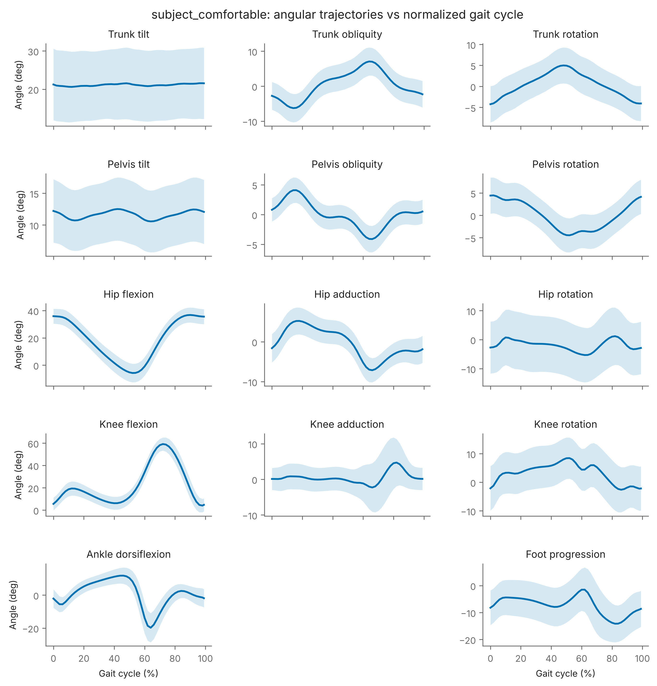
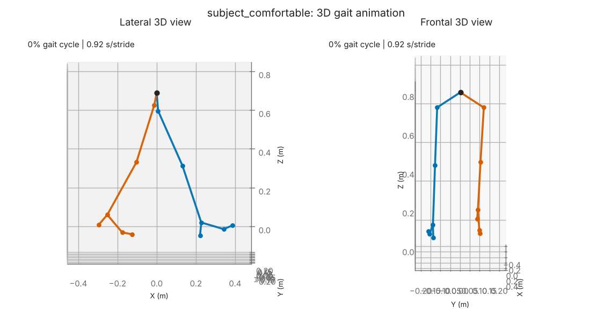

# Usage guide

How to install PediaGait3D, run it, and read what it writes. For the equations
behind each step, see [METHODS.md](METHODS.md).

Contents:

- [Install](#install)
- [Run it](#run-it)
- [Configuration reference](#configuration-reference)
- [Console output](#console-output)
- [Output files](#output-files)
- [Coordinate frames](#coordinate-frames)
- [Working with the tables](#working-with-the-tables)
- [Checking a run](#checking-a-run)
- [Troubleshooting](#troubleshooting)
- [Maintenance](#maintenance)

## Install

Python 3.9 or newer is required (tested with Python 3.13).

```bash
git clone https://github.com/Romerozabal/pedia-gait3d.git
cd pedia-gait3d
python3 -m venv .venv
source .venv/bin/activate
pip install -r requirements.txt
```

`requirements.txt` lists `numpy`, `pandas` and `matplotlib`. Writing the GIF
animation also needs Pillow, which is installed together with matplotlib.

## Run it

There are three ways to describe the subject. All of them write one folder per
subject under `outputs/`. A run takes about ten seconds.

### 1. JSON config file (recommended)

```bash
python3 generate_integrated_normative_gait.py \
  --config configs/subject_gait_config.comfortable_speed.example.json
```

Two example files are provided:

| File | Subject | Purpose |
|------|---------|---------|
| `configs/subject_gait_config.comfortable_speed.example.json` | 9 years, 1.25 m, 1.10 m/s | Comfortable walking speed, inside the Free speed group. Used for the figures in this documentation. |
| `configs/subject_gait_config.example.json` | 9 years, 1.25 m, 0.20 m/s | Very slow, robot-assisted speed. It is below the slowest Schwartz reference, so the Very Slow waveforms are used unchanged. |

Copy one of them, edit the values, and pass the new file with `--config`. When
`--config` is given, every other command-line option is ignored.

### 2. Command-line flags

```bash
python3 generate_integrated_normative_gait.py \
  --patient-id S01 --age-y 6 --height-m 1.15 --speed-m-s 0.9
```

Optional flags: `--leg-length-m`, `--n-points` (default 100), `--out-dir`,
`--schwartz-speed-interpolation {linear,nearest}`. The contact model uses its
default settings in this mode.

### 3. Batch CSV

```csv
patient_id,age_y,height_m,speed_m_s,leg_length_m
S01,5,1.16,1.0,
S02,4,1.05,0.8,0.50
```

```bash
python3 generate_integrated_normative_gait.py \
  --examples-csv path/to/subjects.csv \
  --out-dir outputs/batch_outputs
```

Each row is written to `outputs/batch_outputs/<patient_id>/`. The
`leg_length_m` column is optional and may be left empty. `--n-points` and
`--schwartz-speed-interpolation` apply to all rows; the contact model uses its
default settings.

## Configuration reference

| Key | Required | Default | Meaning |
|-----|----------|---------|---------|
| `patient_id` | yes | | Label used in file contents, figure titles and the default output folder. |
| `age_y` | yes | | Age in years. Used only by the Van Hamme regressions. |
| `height_m` | yes | | Standing height in metres. Scales every body segment. |
| `speed_m_s` | yes | | Walking speed in metres per second. |
| `leg_length_m` | no | `0.530 * height_m` | Measured leg length in metres. Use it when available: it sets the dimensionless speed, the step length and the cadence. `null` means "estimate". |
| `n_points` | no | `100` | Samples per gait cycle (minimum 20). The source curves have 51 samples. |
| `schwartz_speed_interpolation` | no | `"linear"` | `"linear"` blends the two neighbouring speed groups; `"nearest"` uses the closest group unchanged. |
| `out_dir` | no | `outputs/<patient_id>` | Output folder, relative to the repository root. Paths outside the repository are rejected. |
| `export_world_spatial` | no | `true` | Write `world_spatial_joint_trajectories.csv`. |
| `export_d2w_centered` | no | `true` | Write the two `d2w_*` trajectory tables. |
| `contact_model` | no | see below | Foot-ground contact settings. |

`contact_model` keys:

| Key | Default | Meaning |
|-----|---------|---------|
| `enabled` | `true` | `false` replaces the rocker by a fixed heel/forefoot midpoint. |
| `pattern` | `"heel_strike"` | `"heel_strike"`, `"midfoot_strike"` or `"forefoot_strike"`. |
| `stance_start_percent` | `0.0` | Start of stance, % of the gait cycle. |
| `heel_to_flat_percent` | `12.0` | End of the heel-to-flat-foot transition (heel strike pattern). |
| `forefoot_loading_percent` | `45.0` | Start of the forefoot/toe transition (heel strike pattern). |
| `toe_off_percent` | `60.0` | End of stance. Values above 50 create double support. |
| `min_swing_clearance_m` | `0.025` | Accepted for compatibility. It has no effect on the current bilateral reconstruction. |

## Console output

```text
patient_id=subject_comfortable
dimensionless_speed=0.4315 -> Schwartz group: Free (inside_reported_range)
angular_waveforms=Free_to_Fast mode=linear alpha=0.0190 (linear_interpolation_between_group_means)
wrote tables and figures to .../outputs/subject_comfortable
```

- Line 2: the dimensionless speed and the speed group that supplies step length
  and cadence.
- Line 3: the waveforms that were blended. `alpha` is the weight of the faster
  group (0 = slower group only, 1 = faster group only).

Status values worth knowing:

| Status | Meaning |
|--------|---------|
| `inside_reported_range` | `v*` lies inside the reported range of a speed group. |
| `outside_reported_range_closest_group_used` | `v*` is below 0.090, above 0.844, or in a gap between two ranges. The group with the closest mean is used. |
| `linear_interpolation_between_group_means` | Waveforms blended between two groups. |
| `exact_speed_group_mean` | `v*` equals a group mean; that group is used alone. |
| `below_reference_mean_clamped_to_very_slow` | `v*` below 0.172: Very Slow waveforms, no extrapolation. |
| `above_reference_mean_clamped_to_very_fast` | `v*` above 0.694: Very Fast waveforms, no extrapolation. |

The same information is stored in `tables/patient_context.csv`.

## Output files

```text
outputs/<patient_id>/
├── README_OUTPUT.md
├── tables/
└── figures/
```

### Tables

| File | Rows | What it contains |
|------|------|------------------|
| `patient_context.csv` | 1 | Inputs, leg length used, dimensionless speed, speed group and interpolation plan. Start here. |
| `normative_spatiotemporal_reference.csv` | 51 | The 47 Schwartz discrete metrics of the selected speed group, plus `step_length_m`, `cadence_steps_min`, `step_time_s` and `stride_time_s` converted to subject units (`converted_*` columns). |
| `van_hamme_age_speed_discrete_reference.csv` | 29 | Peak angles and peak timings predicted from age and speed, with a `normal_low` to `normal_high` band. |
| `schwartz_speed_matched_angular_profiles.csv` | 42 × `n_points` | 14 angular waveforms × 3 statistics (`mean`, `-1sd`, `+1sd`) in degrees. |
| `d2w_kinematic_model_proportions.csv` | 7 | Segment vectors as a proportion of height and in metres. |
| `contact_phase_model.csv` | 2 × `n_points` | Per side and sample: stance flag, contact weights, support share, ground anchor and pelvis solution. |
| `world_spatial_joint_trajectories.csv` | 13 × `n_points` | Overground 3D positions of the pelvis node and, per side, hip, knee, ankle, forefoot, toe and heel. |
| `d2w_style_spatial_joint_trajectories.csv` | 13 × `n_points` | The same points in the pelvis-fixed D2W frame. |
| `d2w_ankle_command_trajectories.csv` | 2 × `n_points` | Right and left ankle only, with X centred on zero. Not a body skeleton. |
| `spatial_reconstruction_quality.csv` | 24 | Geometric diagnostics with a description for each metric. |

The trajectory tables are in long format: one row per `side` (`R`, `L`, or `C`
for the pelvis node), `joint` and `cycle_percent`, with `x_m`, `y_m`, `z_m`.

### Figures

| File | What it shows |
|------|---------------|
| `schwartz_speed_matched_angular_profiles.png` | The 14 angular waveforms with their ±1 SD band. |
| `spatial_trajectory_three_plane_views.png` | Joint paths in the sagittal, frontal and transverse planes. |
| `spatial_trajectories_vs_normalized_gait_cycle.png` | X, Y, Z of each joint against the gait cycle. |
| `spatial_connected_segments_gait_cycle_gradient.png` | Stick figures over the cycle, shaded by phase. |
| `spatial_gait_3d_frontal_lateral_animation.gif` | Lateral and frontal animation, timed to the stride duration. |

Examples from the comfortable-speed configuration:





## Coordinate frames

Units are metres. Z is vertical and the floor is at `z = 0` in both frames.
The gait cycle starts at right heel strike (`cycle_percent = 0`); the left limb
is half a cycle later.

| Table | Forward | Right side | Pelvis X |
|-------|---------|------------|----------|
| `world_spatial_joint_trajectories.csv` | negative X | positive Y | Advances by two step lengths per cycle |
| `d2w_style_spatial_joint_trajectories.csv` | positive X | negative Y | Fixed at 0 |
| `d2w_ankle_command_trajectories.csv` | positive X | negative Y | Not included; ankle X centred on 0 |

One cycle of the world table covers one stride. To chain several cycles,
subtract `2 * step_length_m` from X for each additional cycle.

The `pelvis` row is a display node drawn above the hip joints. It is not an
anatomical landmark; see the limitations in [METHODS.md](METHODS.md#scope-and-known-limitations).

## Working with the tables

Read the ankle trajectory and put it on a time axis:

```python
import pandas as pd

run = "outputs/subject_comfortable/tables/"
ankle = pd.read_csv(run + "d2w_ankle_command_trajectories.csv")
timing = pd.read_csv(run + "normative_spatiotemporal_reference.csv")

stride_time_s = timing.loc[timing["converted_metric_name"] == "stride_time_s", "converted_mean"].iloc[0]
ankle["time_s"] = ankle["cycle_percent"] / 100.0 * stride_time_s

right = ankle[ankle["side"] == "R"].sort_values("cycle_percent")
print(right[["time_s", "x_m", "y_m", "z_m"]].head())
```

Get one joint as an array of shape `(n_points, 3)`:

```python
traj = pd.read_csv(run + "d2w_style_spatial_joint_trajectories.csv")
knee = (
    traj[(traj["side"] == "L") & (traj["joint"] == "knee")]
    .sort_values("cycle_percent")[["x_m", "y_m", "z_m"]]
    .to_numpy()
)
```

Plot a waveform with its band:

```python
import matplotlib.pyplot as plt

angles = pd.read_csv(run + "schwartz_speed_matched_angular_profiles.csv")
knee_flex = angles[angles["profile_name"] == "knee_flex"].pivot(
    index="cycle_percent", columns="stat", values="value_deg"
)
plt.fill_between(knee_flex.index, knee_flex["-1sd"], knee_flex["+1sd"], alpha=0.2)
plt.plot(knee_flex.index, knee_flex["mean"])
plt.xlabel("Gait cycle (%)")
plt.ylabel("Knee flexion (deg)")
plt.show()
```

The generator can also be used as a module. `docs/make_readme_media.py` shows
how to call the pipeline functions without writing an output folder.

## Checking a run

1. Open `tables/patient_context.csv` and confirm the speed group and the
   interpolation status are what you expect.
2. Watch `figures/spatial_gait_3d_frontal_lateral_animation.gif`.
3. Read `tables/spatial_reconstruction_quality.csv`. Each row carries its own
   description. The most useful ones are explained in
   [METHODS.md](METHODS.md#quality-metrics).

Keep in mind what the numbers are: a reference built from published group
averages, not a measurement of the subject.

- Age changes only the Van Hamme table. The 3D trajectory depends on height,
  leg length and speed.
- Step length and cadence come from one speed group. If the requested speed is
  far from that group's mean, the overground layer progresses at the group's
  speed, not at the requested one.
- For ages outside one to seven years, the Van Hamme values are extrapolated.

## Troubleshooting

| Message | Cause and fix |
|---------|---------------|
| `ModuleNotFoundError: No module named 'numpy'` | The dependencies are installed for another Python. Activate the virtual environment, or run `python3 -m pip install -r requirements.txt` with the same `python3` you use to run the script. |
| `Output directory must stay inside the package directory` | `out_dir` points outside the repository. Use a relative path such as `outputs/my_subject`. |
| `Missing required arguments. Use --config or provide: ...` | No `--config` and one of the four required flags is missing. |
| `... is missing required config keys` | The JSON file lacks `patient_id`, `age_y`, `height_m` or `speed_m_s`. |
| `n_points must be at least 20.` | Raise `n_points` in the config. |
| `Unknown contact pattern` | `contact_model.pattern` must be `heel_strike`, `midfoot_strike` or `forefoot_strike`. |

## Maintenance

### Regenerate the documentation media

```bash
python3 docs/make_readme_media.py
```

This rebuilds everything in `docs/media/` from the comfortable-speed example
configuration, using the generator's own functions.

### Verify the package manifest

`PACKAGE_MANIFEST.csv` lists a SHA-256 checksum and size for each versioned
file:

```bash
python3 - <<'PY'
import csv
import hashlib
from pathlib import Path

errors = []
root = Path(".")

with open("PACKAGE_MANIFEST.csv", newline="") as f:
    for row in csv.DictReader(f):
        path = root / row["package_path"]
        if not path.exists():
            errors.append((row["package_path"], "missing"))
            continue
        data = path.read_bytes()
        sha = hashlib.sha256(data).hexdigest()
        size = str(len(data))
        if sha != row["sha256"] or size != row["size_bytes"]:
            errors.append((row["package_path"], sha, size))

if errors:
    print("PACKAGE_MANIFEST.csv: FAIL")
    for item in errors:
        print(item)
    raise SystemExit(1)

print("PACKAGE_MANIFEST.csv: OK")
PY
```

### Minimal validation run

```bash
python3 -m py_compile generate_integrated_normative_gait.py
python3 generate_integrated_normative_gait.py \
  --config configs/subject_gait_config.example.json
```

The run should create ten CSV tables, four PNG figures and one GIF animation
inside `outputs/<patient_id>/`.
